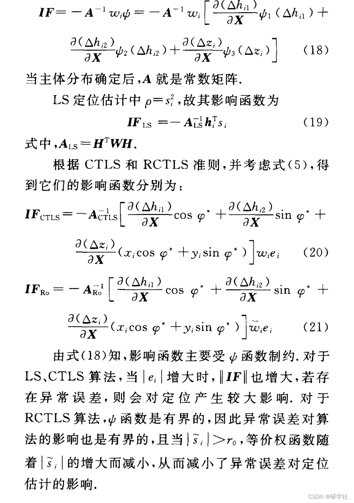
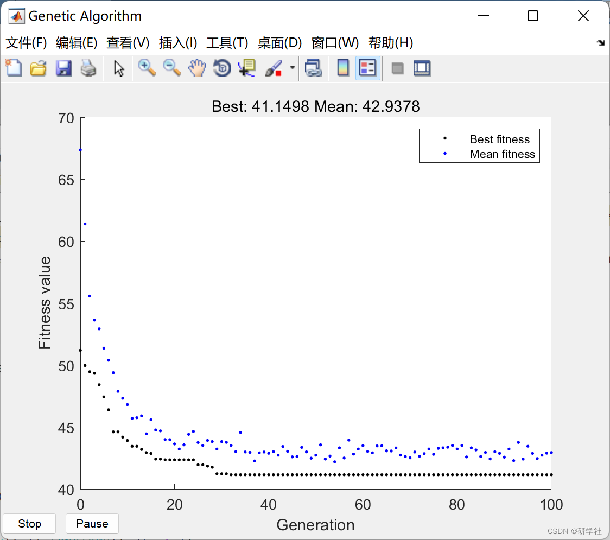
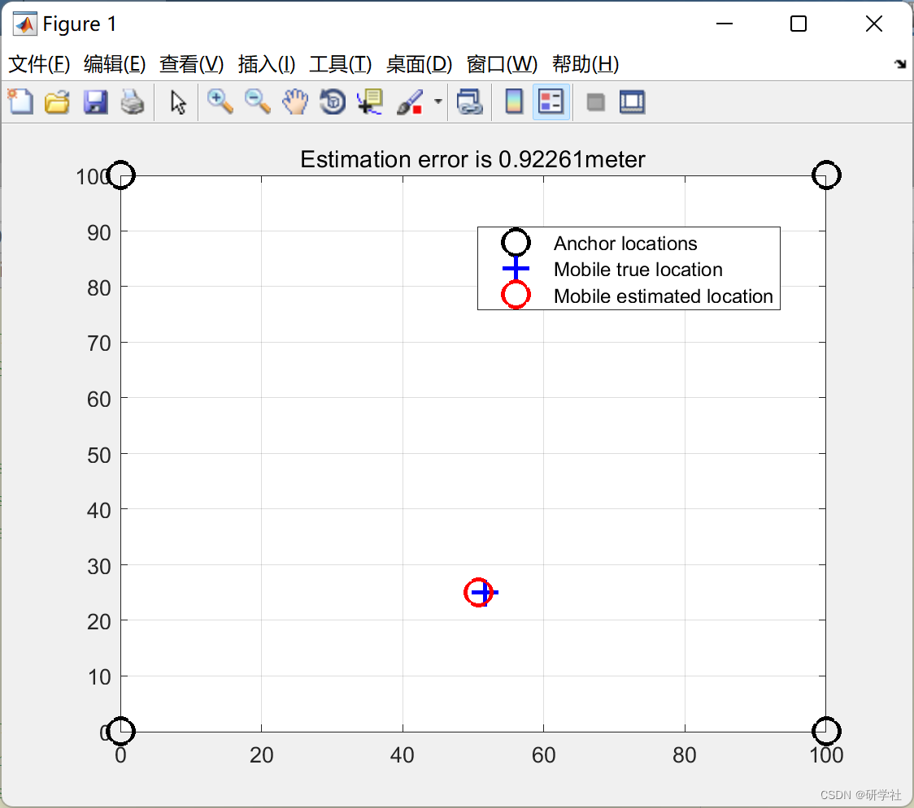
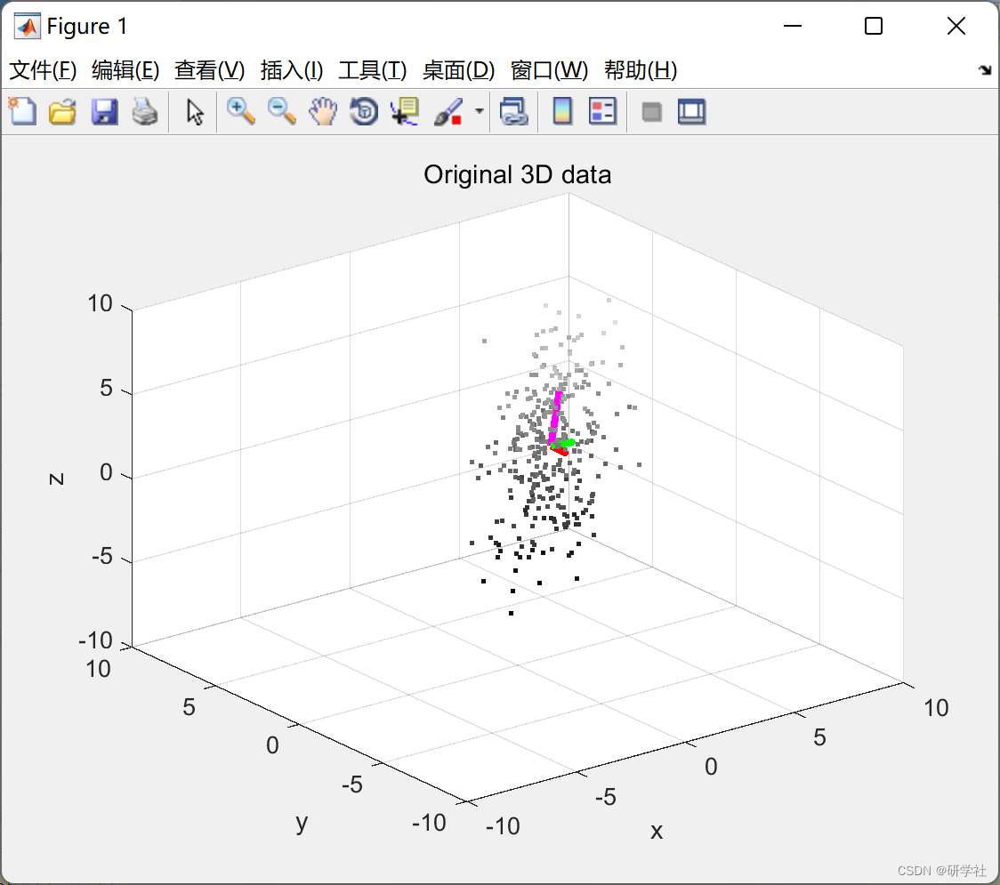
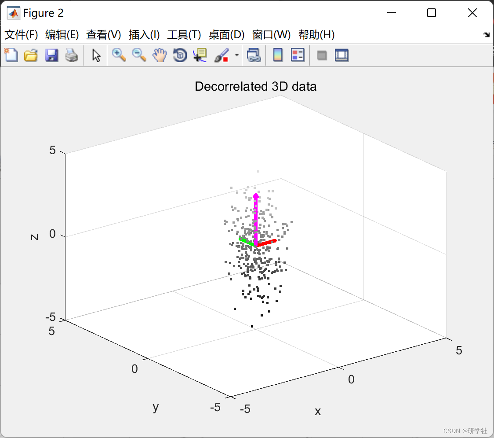
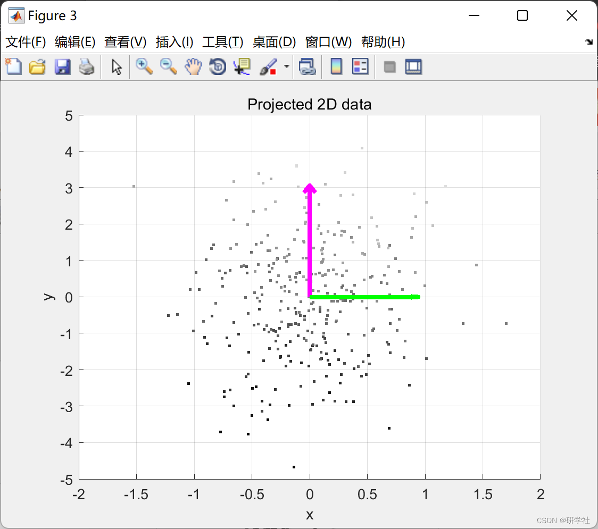

# Robust Unbounded Grid Algorithm (RRGA) (Matlab Code Implementation)

💥💥💞💞 Welcome to this blog❤️❤️💥💥
🏆 Bloggers' Advantages: 🌞🌞🌞 The content of the blog strives for rigorous thinking and clear logic to facilitate readers.
⛳️ Mantra: A journey of a thousand miles is begun with a single step. Directory 💥1 Overview📚2 Run results🎉3 References🌈4 MATLAB Code Implementation
💥1 Overview The ability to resist abnormal errors in valuation can be quantitatively analyzed using an impact function. The impact function reflects the relative impact of abnormal data at different locations, with smaller absolute values indicating stronger resistance to errors [11]. The impact function shown in equation (11) for the generalized M estimation criterion is:
​ Edit
📚2 Run results Edit
​ Edit
​ Edit
Part of the code:
scatter3(data(:,1), data(:,2), data(:,3), 5, data(:,3), 'filled');
colormap(gray);
% Calculate the eigenvectors and eigenvalues
covariance = cov(data);
tt1=data(:,1)-avg(1);tt2=data(:,2)-avg(2);tt3=data(:,3)-avg(3);
tt=[tt1 tt2 tt3];
cc=1/333*(transpose(tt)*tt);
[eigenvec, eigenval ] = eig(covariance);
% Get the index of the largest eigenvector
largest_eigenvec = eigenvec(:, 3);
largest_eigenval = eigenval(3,3);
medium_eigenvec = eigenvec(:, 2);  
medium_eigenval = eigenval(2,2);  
smallest_eigenvec = eigenvec(:, 1);  
smallest_eigenval = eigenval(1,1);  
% Plot the eigenvectors  
hold on;  
quiver3(X0, Y0, Z0, largest_eigenvec(1)*sqrt(largest_eigenval), largest_eigenvec(2)*sqrt(largest_eigenval), largest_eigenvec(3)*sqrt(largest_eigenval), '-m', 'LineWidth',3);  
quiver3(X0, Y0, Z0, medium_eigenvec(1)*sqrt(medium_eigenval), medium_eigenvec(2)*sqrt(medium_eigenval), medium_eigenvec(3)*sqrt(medium_eigenval), '-g', 'LineWidth',3);  
quiver3(X0, Y0, Z0, smallest_eigenvec(1)*sqrt(smallest_eigenval), smallest_eigenvec(2)*sqrt(smallest_eigenval), smallest_eigenvec(3)*sqrt(smallest_eigenval), '-r', 'LineWidth',3);  
hold on;  
% Set the axis labels  
hXLabel = xlabel('x');  
hYLabel = ylabel('y');  
hZLabel = zlabel('z');  
xlim([-10,10]);  
ylim([-10,10]);  
zlim([-10,10]);  
title('Original 3D data');  
%%%%%%%%%%%%% CENTER THE DATA %%%%%%%%%%%  
data = data-repmat(avg, size(data, 1), 1);  
%%%%%%%%%%%%% NORMALIZE THE DATA %%%%%%%%%%%  
stdev = sqrt(diag(covariance));  
data = data./repmat(stdev', size(data, 1), 1);  
%%%%%%%%%%%%% DECORRELATE THE DATA %%%%%%%%%%%  
decorrelateddata = (data*eigenvec);  
% Plot the decorrelated data  
figure;  
scatter3(decorrelateddata(:,1), decorrelateddata(:,2), decorrelateddata(:,3), 5, decorrelateddata(:,3), 'filled');  
colormap(gray);  
% Plot the eigenvectors (which are now the axes (0,0,1), (0,1,0), (1,0,0)  
% and the mean of the centered data is at (0,0,0)  
hold on;  
quiver3(0, 0, 0, 0, 0, 1*sqrt(largest_eigenval), '-m', 'LineWidth',3);  
quiver3(0, 0, 0, 0, 1*sqrt(medium_eigenval), 0, '-g', 'LineWidth',3);  
quiver3(0, 0, 0, 1*sqrt(smallest_eigenval), 0, 0, '-r', 'LineWidth',3);  
hold on;  
% Set the axis labels  
hXLabel = xlabel('x');  
hYLabel = ylabel('y');  
hZLabel = zlabel('z');  
xlim([-5,5]);  
ylim([-5,5]);  
zlim([-5,5]);  
title('Decorrelated 3D data');  
%%%%%%%%%%%%% PROJECT THE DATA ONTO THE 2 LARGEST EIGENVECTORS %%%%%%%%%%%  
eigenvec_2d=eigenvec(:,2:3);  
data_2d = data*eigenvec_2d;  
% Plot the 2D data  
figure;  
scatter(data_2d(:,1), data_2d(:,2), 5, data(:,3), 'filled');  
colormap(gray);  
% Plot the eigenvectors  
hold on;  
quiver(0, 0, 0*sqrt(largest_eigenval), 1*sqrt(largest_eigenval), '-m', 'LineWidth',3);  
quiver(0, 0, 1*sqrt(medium_eigenval), 0*sqrt(medium_eigenval), '-g', 'LineWidth',3);  
hold on;  
% Set the axis labels  
hxLabel = xlabel('x');  
hyLabel = ylabel('y');  
ylim([-5,5]);  
ylim([-5,5]);  
title('Projected 2D data');  
grid on;  
%%%%%%%%%%%%% PROJECT THE DATA ONTO THE LARGEST EIGENVECTOR %%%%%%%%%%%  
eigenvec_1d=eigenvec(:,3);  
data_1d = data*eigenvec_1d;  
% Plot the 1D data  
figure;  
scatter(repmat(0, size(data_1d,1), 1), data_1d, 5, data(:,3), 'filled');  
colormap(gray);  
% Plot the eigenvector  
hold on;  
quiver(0, 0, 0*sqrt(largest_eigenval), 1*sqrt(largest_eigenval), '-m', 'LineWidth',3);  
hold on;  
% Set the axis labels  
hXLabel = xlabel('x');  
hYLabel = ylabel('y');  
xlim([-5,5]);  
ylim([-5,5]);  
title('Projected 1D data');  
grid on;  
🎉3 References
[2] Wu Er Yong, Xiang Zhiyu, Liu Jilin. Robust Monte Carlo Positioning Algorithm for Robots [J]. Journal of Automation, 2008, 34(8): 907-911
[3] Wu Hao, Chen Shuxin, Hou Zhiqiang, Huo Chenjie. A Robust Constrained Total Least Squares Passive Positioning Algorithm [J]. Journal of Shanghai Jiao Tong University, 2013, 47(7): 1114-1118
🌈4 Matlab code implementation

## Images

<!-- PAYMENT_BLOCK -->

## Get this dataset

- Payment link (Stripe): [Buy now](https://buy.stripe.com/3cs8yP7sY87d0vu9AB)
- Payment QR code: 

<!-- /PAYMENT_BLOCK -->
